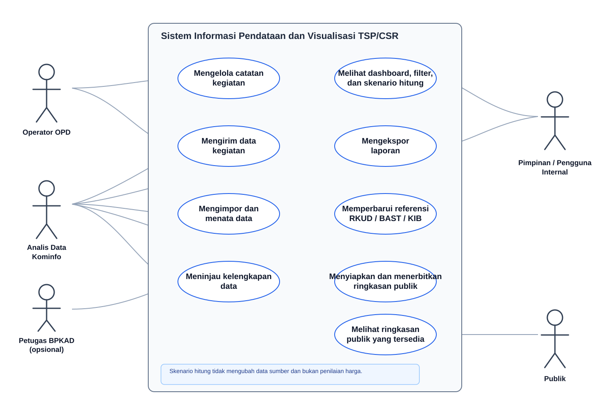
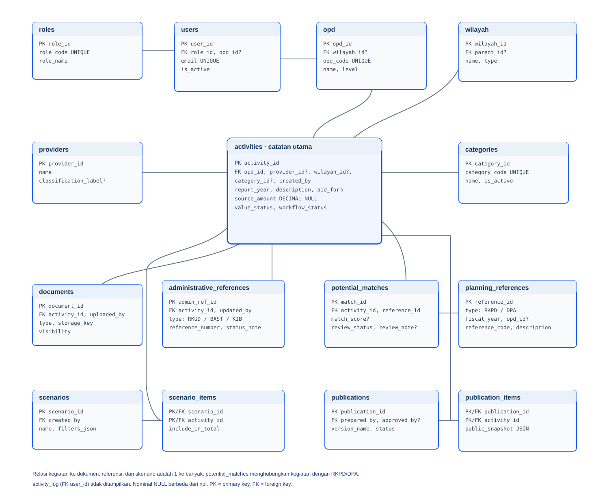

# Software Requirements Specification (SRS)

## Sistem Informasi Pendataan dan Visualisasi TSP/CSR Kota Samarinda

| Atribut | Nilai |
|---|---|
| Status | Draf untuk ditinjau |
| Versi | 0.1 |
| Tanggal | 16 Oktober 2026 |
| Pemilik kebutuhan | Pemerintah Kota Samarinda (perlu penetapan unit pemilik sistem) |
| Penyusun draf | Berdasarkan dashboard CSR yang tersedia dan materi arahan pada `IMG_4891.HEIC` |

> Dokumen ini adalah draf kebutuhan sistem, bukan dokumen kebijakan, pendapat hukum, hasil audit, atau penilaian kewajaran nilai bantuan. Nama unit, kewenangan, alur persetujuan, dan aturan publikasi perlu dikonfirmasi oleh Pemkot sebelum pengembangan.

## 1. Pendahuluan

### 1.1 Tujuan

SRS ini mendefinisikan kebutuhan awal untuk sistem yang membantu Pemkot Samarinda mencatat, mengelola, merangkum, dan menyajikan data Tanggung Jawab Sosial Perusahaan (TSP/CSR). Dokumen menjadi acuan diskusi antara calon pemilik sistem, OPD pengelola data, tim teknis, dan pihak yang menggunakan laporan.

### 1.2 Ruang lingkup produk

Sistem yang diusulkan menyediakan satu sumber data TSP/CSR dengan fungsi inti:

- menerima data kontribusi dari OPD dan/atau impor berkas terstruktur;
- menata data perusahaan, bentuk dan nilai kontribusi, lokasi, penerima/manfaat, periode, dan dokumen serah terima;
- memberi ringkasan dan visualisasi yang dapat disaring menurut tahun, OPD, wilayah, bentuk bantuan, dan kategori;
- membantu membandingkan daftar kegiatan dengan daftar prioritas pembangunan atau data RKPD/DPA yang tersedia;
- mencatat informasi administratif terkait status penyaluran uang/barang dan referensi pencatatan aset, tanpa melakukan pembukuan atau penetapan nilai aset;
- menghasilkan laporan untuk pengguna internal dan, bila disetujui, ringkasan publik.

Materi arahan pada gambar menjadi konteks kebutuhan: regulasi dan kelembagaan, data satu pintu, sinkronisasi kegiatan, informasi akuntansi/aset, serta integritas. Sistem mendukung pencatatan dan penyediaan informasi untuk konteks tersebut; sistem tidak menggantikan keputusan pejabat atau proses resmi masing-masing unit.

### 1.3 Batasan ruang lingkup

Sistem ini bukan aplikasi untuk melakukan audit, pemeriksaan fisik, penilaian kewajaran harga, penyelidikan, pengambilan keputusan hukum, pemrosesan transaksi keuangan, penetapan status resmi CSR, atau pencatatan jurnal akuntansi. Perbandingan, penanda, dan skenario pada dashboard hanya menjelaskan isi data dan dampak perhitungan.

### 1.4 Istilah

| Istilah | Arti dalam dokumen |
|---|---|
| TSP/CSR | Tanggung Jawab Sosial Perusahaan / Corporate Social Responsibility; istilah mengikuti kebijakan Pemkot yang berlaku. |
| OPD | Perangkat Daerah yang mengirim atau menggunakan data kegiatan. |
| BAST | Berita Acara Serah Terima; sistem menyimpan referensi atau lampiran, bukan mengesahkan dokumennya. |
| RKPD/DPA | Data perencanaan dan penganggaran yang dapat dipakai sebagai referensi pembanding bila tersedia. |
| KIB | Kartu Inventaris Barang; sistem dapat menyimpan nomor referensi pencatatan yang diisi unit berwenang. |
| Skenario hitung | Perhitungan alternatif yang memasukkan atau mengecualikan baris tertentu tanpa mengubah data sumber. |

## 2. Gambaran umum

### 2.1 Konteks produk

Produk sasaran adalah aplikasi web internal dengan dashboard dan repositori data terstruktur. Dashboard lokal yang sudah tersedia diperlakukan sebagai prototipe visualisasi, bukan sebagai bukti bahwa semua kebutuhan pada SRS ini telah diimplementasikan. Data awal dapat berasal dari Excel; integrasi langsung dengan sistem RKPD, DPA, RKUD, KIB, atau portal publik belum diasumsikan tersedia.

### 2.2 Kelas pengguna

| Pengguna | Kebutuhan dan kewenangan yang diusulkan |
|---|---|
| Operator OPD | Mengisi, memperbarui, melengkapi, dan mengirim data kegiatan OPD-nya sendiri. |
| Analis data Kominfo | Mengimpor dan menata data, mengelola klasifikasi, memeriksa kelengkapan/format, membuat ringkasan, dan menyiapkan publikasi. Peran ini tidak mencakup audit atau validasi kewajaran harga. |
| Petugas BPKAD (opsional) | Mengisi atau memperbarui referensi administratif penyaluran dan pencatatan aset sesuai kewenangannya; bukan melakukan pembukuan di dalam sistem ini. |
| Pimpinan/pengguna internal | Melihat dashboard dan mengunduh laporan sesuai hak akses. |
| Publik | Melihat ringkasan yang telah disetujui untuk dipublikasikan; tidak melihat data personal atau lampiran internal. |

Penetapan unit pemilik sistem, admin akun, petugas yang boleh menyetujui publikasi, dan batas akses setiap peran masih harus dikonfirmasi.

### 2.3 Lingkungan operasi

- Aplikasi web yang dapat digunakan melalui peramban desktop dan perangkat seluler.
- Penyimpanan data terpusat pada infrastruktur yang disetujui Pemkot.
- Format impor awal: XLSX dan CSV dengan templat kolom yang ditetapkan.
- Koneksi eksternal ke sistem lain tidak menjadi prasyarat versi awal.

### 2.4 Asumsi dan ketergantungan

1. OPD menyediakan data dan dokumen sumber melalui proses yang ditetapkan Pemkot.
2. Pemkot menetapkan definisi data, format templat, klasifikasi, retensi dokumen, serta pejabat/unit yang menyetujui publikasi.
3. Integrasi RKPD/DPA, RKUD, KIB, SSO, dan portal publik hanya dilakukan setelah tersedia akses, spesifikasi, dan persetujuan pemilik sistem terkait.
4. Data nilai yang kosong, nol, atau berbeda tidak otomatis dikoreksi oleh sistem.
5. Aturan hukum pada materi gambar menjadi rujukan kebijakan yang perlu ditelaah oleh unit berwenang; SRS ini tidak menyatakan kepatuhan hukum.

## 3. Kebutuhan antarmuka eksternal

### 3.1 Antarmuka pengguna

- Formulir entri data dengan label berbahasa Indonesia, petunjuk kolom, validasi format, dan pesan kesalahan yang dapat dipahami.
- Dashboard dengan filter periode, OPD, wilayah, bentuk bantuan, kategori, dan status kelengkapan.
- Tabel detail dengan pencarian, pengurutan, paginasi, serta ekspor sesuai kewenangan.
- Tampilan publik terpisah dari tampilan internal jika fitur publikasi diaktifkan.

### 3.2 Antarmuka perangkat lunak dan data

- Impor/ekspor XLSX dan CSV melalui templat resmi sistem.
- API internal untuk menyediakan data dashboard, dengan autentikasi dan pembatasan akses.
- Integrasi lain (RKPD/DPA/RKUD/KIB/portal) bersifat opsional dan menunggu spesifikasi teknis serta persetujuan pemilik data.

### 3.3 Antarmuka dokumen

Lampiran dapat memuat dokumen sumber atau BAST. Sistem menyimpan berkas dan metadata (nama, jenis, tanggal, OPD pengunggah); penyimpanan lampiran, ukuran maksimum, format yang diperbolehkan, dan retensi harus ditetapkan oleh Pemkot.

## 4. Kebutuhan fungsional

| ID | Kebutuhan |
|---|---|
| FR-01 | Sistem harus mengautentikasi pengguna sebelum memberikan akses ke fitur internal. |
| FR-02 | Admin sistem harus dapat membuat, menonaktifkan, dan menetapkan peran akun pengguna. |
| FR-03 | Operator OPD harus dapat membuat dan memperbarui catatan kegiatan yang berada dalam cakupan OPD-nya. |
| FR-04 | Sistem harus menyediakan kolom minimal: tahun/periode, nama pemberi, OPD, uraian, bentuk bantuan, nominal (bila tercantum), lokasi, penerima/sasaran, kategori, referensi dokumen/BAST, dan status kelengkapan. |
| FR-05 | Sistem harus menyimpan nilai sebagaimana diterima dari sumber dan menampilkan mata uang serta satuan secara konsisten; sistem tidak boleh mengubah nilai tanpa tindakan pengguna berwenang dan jejak perubahan. |
| FR-06 | Sistem harus mendukung nilai nominal kosong atau tidak diketahui sebagai keadaan berbeda dari nilai nol. |
| FR-07 | Sistem harus memungkinkan lampiran atau referensi dokumen sumber pada catatan kegiatan sesuai kebijakan akses. |
| FR-08 | Sistem harus memvalidasi kolom wajib, format tanggal/tahun, tipe data nominal, dan pilihan referensi sebelum data disimpan atau dikirim. |
| FR-09 | Sistem harus menampilkan peringatan potensi duplikasi berdasarkan kombinasi atribut yang dapat dikonfigurasi; peringatan tidak menghapus atau menggabungkan catatan otomatis. |
| FR-10 | Analis data Kominfo harus dapat mengimpor XLSX/CSV, melihat pratinjau, memetakan kolom, menampilkan kesalahan per baris, dan membatalkan impor sebelum data diterapkan. |
| FR-11 | Sistem harus menyediakan proses pengiriman data dari Operator OPD dan status administratif (draf, dikirim, dikembalikan untuk dilengkapi, siap diringkas). |
| FR-12 | Analis data Kominfo harus dapat meninjau kelengkapan dan konsistensi format, serta mengembalikan data dengan catatan perbaikan. Fungsi ini bukan pemeriksaan fisik, audit, atau validasi kewajaran nilai. |
| FR-13 | Sistem harus menyediakan pengelolaan kamus kategori, bentuk bantuan, OPD, wilayah, periode, dan label lainnya oleh pengguna berwenang. |
| FR-14 | Dashboard harus menyajikan jumlah catatan dan agregat nominal menurut periode, OPD, wilayah, bentuk bantuan, serta kategori yang tersedia. |
| FR-15 | Pengguna internal harus dapat mencari, menyaring, mengurutkan, dan membuka detail data sesuai hak akses. |
| FR-16 | Sistem harus memungkinkan pengguna membuat skenario perhitungan dengan memasukkan atau mengecualikan catatan tertentu tanpa mengubah nilai atau status data sumber. Hasil skenario harus diberi label jelas dan tidak disebut nilai koreksi/final. |
| FR-17 | Sistem dapat mencocokkan data kegiatan dengan daftar prioritas RKPD/DPA yang diimpor, lalu menampilkan potensi kecocokan atau kemiripan untuk ditinjau pengguna. Sistem tidak boleh menyatakan telah terjadi pendanaan ganda hanya dari kemiripan data. |
| FR-18 | Sistem dapat menyimpan informasi administratif berupa status penyaluran uang/barang dan referensi RKUD/BAST/KIB yang dimasukkan unit berwenang. Sistem tidak melakukan transaksi, jurnal akuntansi, penetapan hibah, atau pengakuan aset. |
| FR-19 | Analis data Kominfo harus dapat menghasilkan laporan ringkas dan mengekspor hasil sesuai filter dalam format yang ditentukan (XLSX/CSV; PDF bila disepakati). |
| FR-20 | Pengguna berwenang harus dapat menyiapkan ringkasan publik terpisah, meninjau pratinjau, dan menerbitkannya setelah persetujuan unit/pejabat yang ditetapkan Pemkot. |
| FR-21 | Sistem harus menyamarkan atau menghilangkan data personal dan lampiran internal dari tampilan publik. |
| FR-22 | Sistem harus merekam riwayat aktivitas penting (pengguna, waktu, tindakan, dan perubahan nilai) untuk keterlacakan operasional. Riwayat ini bukan modul audit atau kesimpulan audit. |

## 5. Data dan aturan bisnis

### 5.1 Entitas data utama

| Entitas | Atribut inti |
|---|---|
| Kegiatan TSP/CSR | ID, periode, OPD, uraian, kategori, bentuk bantuan, nominal sumber, status kelengkapan, lokasi, penerima/sasaran |
| Pemberi | ID/nama, jenis menurut klasifikasi sistem, kontak bila diizinkan, sumber informasi |
| Dokumen pendukung | Jenis dokumen, nomor/referensi, tanggal, berkas/lokasi simpan, pengunggah |
| Referensi perencanaan | Tahun, kode/nama prioritas RKPD/DPA, sumber impor |
| Referensi penyaluran/aset | Status administratif, nomor referensi RKUD/BAST/KIB, unit pengisi, tanggal pembaruan |
| Pengguna dan peran | ID akun, unit kerja, peran, status akun |
| Riwayat aktivitas | Pengguna, waktu, entitas, aksi, nilai sebelum/sesudah bila relevan |

### 5.2 Aturan bisnis

1. Satu catatan mewakili satu kegiatan atau kontribusi sebagaimana struktur data yang disepakati; aturan untuk baris lanjutan dan subtotal dari Excel harus ditentukan dalam templat impor.
2. Nilai kosong, nol, dan nilai nominal harus disimpan dan dilaporkan secara berbeda.
3. Sistem menyimpan nilai sumber; pengubahan nilai harus mencatat alasan dan riwayat sebelum/sesudah.
4. Klasifikasi otomatis adalah label bantu, bukan penetapan status hukum atau status resmi TSP/CSR.
5. Catatan dengan nominal ekstrem atau berbeda dari catatan lain hanya boleh diberi penanda deskriptif atau dipilih dalam skenario hitung; sistem tidak menyimpulkan penyebab atau harga wajar.
6. Ringkasan hanya mencakup data dengan status yang sesuai filter/persetujuan publikasi.
7. Perbandingan dengan RKPD/DPA menunjukkan kecocokan data potensial, bukan bukti tumpang tindih anggaran.
8. Referensi BAST, RKUD, dan KIB merupakan metadata administratif; sistem tidak mengesahkan dokumen atau mengambil keputusan pencatatan.

## 6. Kebutuhan nonfungsional

| ID | Kebutuhan |
|---|---|
| NFR-01 Keamanan | Akses internal harus memakai autentikasi, kontrol peran, dan prinsip hak akses minimum. |
| NFR-02 Privasi | Data personal, kontak, dan dokumen internal tidak boleh tampil di halaman publik tanpa dasar dan persetujuan yang ditetapkan Pemkot. |
| NFR-03 Keterlacakan | Perubahan catatan penting harus menyimpan pelaku dan waktu perubahan serta dapat ditelusuri pengguna berwenang. |
| NFR-04 Integritas data | Impor harus dapat divalidasi sebelum diterapkan; kegagalan impor tidak boleh meninggalkan data setengah terproses. |
| NFR-05 Kinerja | Untuk hingga 10.000 catatan, pencarian/filter dashboard umum sebaiknya selesai dalam 3 detik pada jaringan internal yang memenuhi kapasitas yang disepakati. |
| NFR-06 Kegunaan | Antarmuka harus berbahasa Indonesia, responsif, menyediakan pesan validasi yang jelas, dan tidak mengharuskan pengguna memahami istilah teknis. |
| NFR-07 Aksesibilitas | Navigasi utama dapat digunakan dengan keyboard; warna bukan satu-satunya pembeda status; kontras teks memenuhi pedoman aksesibilitas yang dipilih tim. |
| NFR-08 Ketersediaan | Target ketersediaan dan jadwal pemeliharaan ditetapkan bersama pemilik infrastruktur sebelum produksi. |
| NFR-09 Pemulihan | Pencadangan, retensi, dan uji pemulihan data harus ditetapkan oleh pengelola infrastruktur Pemkot. |
| NFR-10 Kompatibilitas | Versi peramban dan ukuran layar minimum yang didukung harus ditetapkan saat desain teknis; tampilan wajib tetap terbaca pada desktop dan ponsel. |

## 7. Use case

### 7.1 Daftar use case

| ID | Use case | Aktor utama | Hasil |
|---|---|---|---|
| UC-01 | Mengelola catatan kegiatan | Operator OPD | Catatan dibuat/diperbarui dan tersimpan sebagai draf. |
| UC-02 | Mengirim data kegiatan | Operator OPD | Data dikirim untuk peninjauan kelengkapan administratif. |
| UC-03 | Mengimpor dan menata data | Analis data Kominfo | Data berhasil dipetakan dan diimpor atau kesalahan per baris ditampilkan. |
| UC-04 | Meninjau kelengkapan data | Analis data Kominfo | Data ditandai siap diringkas atau dikembalikan dengan catatan kelengkapan. |
| UC-05 | Menganalisis dan membuat skenario | Analis data Kominfo | Dashboard dan skenario hitung dihasilkan tanpa mengubah data sumber. |
| UC-06 | Memperbarui referensi administratif | Petugas BPKAD (opsional) | Referensi/status RKUD, BAST, atau KIB tersimpan sesuai akses. |
| UC-07 | Melihat ringkasan internal | Pimpinan/pengguna internal | Ringkasan dan laporan ditampilkan sesuai hak akses. |
| UC-08 | Menerbitkan ringkasan publik | Pengguna publikasi yang ditetapkan | Ringkasan yang telah disetujui tersedia tanpa data internal terbatas. |
| UC-09 | Melihat ringkasan publik | Publik | Informasi yang telah disetujui dapat dilihat tanpa akses ke data internal. |

### 7.2 Alur inti UC-04 — Meninjau kelengkapan data

1. Analis data membuka data berstatus “Dikirim”.
2. Sistem menampilkan kolom wajib, format, duplikasi potensial, dan dokumen yang tercatat.
3. Analis menandai kelengkapan administratif berdasarkan aturan yang disepakati.
4. Jika ada informasi yang kurang, analis menulis catatan dan mengembalikan data ke OPD.
5. Jika isian memenuhi kriteria kelengkapan, analis mengubah status menjadi “Siap diringkas”.
6. Perubahan status tercatat dalam riwayat aktivitas.

Alur ini hanya mengelola kelengkapan data; tidak menetapkan kebenaran fisik, kewajaran nilai, kepatuhan, atau hasil pemeriksaan.

### 7.3 Alur inti UC-05 — Menganalisis dan membuat skenario

1. Analis memilih periode, OPD, wilayah, kategori, atau bentuk bantuan.
2. Sistem memperbarui tabel dan visualisasi berdasarkan filter.
3. Analis dapat memilih catatan untuk skenario tanpa mengubah dataset sumber.
4. Sistem menampilkan jumlah catatan, nilai agregat, dan penjelasan bahwa angka merupakan hasil skenario.
5. Analis mengekspor hasil dengan filter dan keterangan skenario yang aktif.

### 7.4 Diagram use case

Sumber diagram yang dapat diedit: [`use_case_tsp_csr.puml`](use_case_tsp_csr.puml).

## 8. Rancangan basis data

### 8.1 Pendekatan

Model data logis menggunakan relasi terpisah untuk master, kegiatan, dokumen, referensi perencanaan, dan riwayat aktivitas. Satu kegiatan tetap disimpan sebagai satu catatan sumber; skenario hitung, klasifikasi, dan hasil pencocokan tidak mengubah nilai sumber. Diagram berikut menunjukkan entitas inti dan relasi utama.

### 8.2 Diagram relasi utama

Sumber diagram yang dapat diedit: [`database_erd.puml`](database_erd.puml).

### 8.3 Kamus tabel

| Tabel | Kunci dan atribut utama | Tujuan |
|---|---|---|
| `roles` | `role_id` PK, `role_code` UNIQUE, `role_name` | Daftar peran akses sistem. |
| `users` | `user_id` PK, `role_id` FK, `opd_id` FK nullable, `name`, `email` UNIQUE, `is_active` | Akun; OPD boleh kosong untuk peran lintas unit. |
| `opd` | `opd_id` PK, `opd_code` UNIQUE, `name`, `level`, `wilayah_id` FK nullable, `is_active` | Master perangkat daerah. |
| `wilayah` | `wilayah_id` PK, `parent_id` FK nullable, `name`, `type` | Hierarki wilayah (kota, kecamatan, kelurahan). |
| `providers` | `provider_id` PK, `name`, `classification_label` nullable, `source_note` nullable | Master pemberi; klasifikasi adalah label data, bukan penetapan status resmi. |
| `categories` | `category_id` PK, `category_code` UNIQUE, `name`, `is_active` | Kamus kategori kegiatan. |
| `activities` | `activity_id` PK, `report_year`, `opd_id` FK, `provider_id` FK nullable, `wilayah_id` FK nullable, `category_id` FK nullable, `description`, `aid_form`, `source_amount` nullable, `value_status`, `workflow_status`, `created_by` FK | Catatan utama kegiatan dan nilai sebagaimana sumber. |
| `documents` | `document_id` PK, `activity_id` FK, `document_type`, `document_number` nullable, `document_date` nullable, `storage_key`, `visibility`, `uploaded_by` FK | Metadata dan lokasi penyimpanan dokumen pendukung. |
| `planning_references` | `reference_id` PK, `reference_type` (RKPD/DPA), `fiscal_year`, `opd_id` FK nullable, `reference_code`, `description` | Baris referensi perencanaan yang diimpor. |
| `potential_matches` | `match_id` PK, `activity_id` FK, `reference_id` FK, `match_score` nullable, `review_status`, `review_note` nullable | Kandidat kecocokan kegiatan dengan prioritas; bukan keputusan pendanaan ganda. |
| `administrative_references` | `admin_ref_id` PK, `activity_id` FK, `reference_type` (RKUD/BAST/KIB), `reference_number` nullable, `status_note` nullable, `updated_by` FK | Referensi administratif dari unit berwenang. |
| `scenarios` | `scenario_id` PK, `name`, `filters_json`, `created_by` FK, `created_at` | Parameter analisis tersimpan (bila fitur simpan skenario diaktifkan). |
| `scenario_items` | `scenario_id` FK, `activity_id` FK, `include_in_total`, PK gabungan | Catatan yang disertakan/dikecualikan pada skenario; tidak mengubah `activities`. |
| `publications` | `publication_id` PK, `version_name`, `status`, `prepared_by` FK, `approved_by` FK nullable, `published_at` nullable | Versi ringkasan publik dan status persetujuannya. |
| `publication_items` | `publication_id` FK, `activity_id` FK, `public_snapshot` JSON, PK gabungan | Snapshot atribut yang aman untuk publik pada saat penerbitan. |
| `activity_log` | `log_id` PK, `user_id` FK, `entity_type`, `entity_id`, `action`, `changed_at`, `before_data` JSON nullable, `after_data` JSON nullable | Riwayat perubahan untuk keterlacakan operasional. |

### 8.4 Relasi dan kardinalitas

- Satu `role` dapat dimiliki banyak `users`; satu `user` memiliki satu peran aktif.
- Satu `opd` dapat memiliki banyak `users` dan banyak `activities`.
- Satu `provider`, `wilayah`, atau `category` dapat terkait dengan banyak `activities`; data pemberi/wilayah/kategori pada satu kegiatan boleh belum diketahui sesuai aturan kelengkapan.
- Satu `activity` dapat memiliki banyak `documents` dan `administrative_references`.
- `activities` dan `planning_references` berelasi many-to-many melalui `potential_matches`.
- `scenarios` dan `activities` berelasi many-to-many melalui `scenario_items`.
- `publications` dan `activities` berelasi many-to-many melalui `publication_items`, yang menyimpan snapshot data publik.
- Satu `user` dapat menghasilkan banyak baris `activity_log`.

### 8.5 Aturan integritas data

1. `source_amount` memakai tipe desimal (bukan floating point), bernilai NULL bila nominal tidak tersedia, dan tidak negatif bila tercatat sebagai nominal.
2. `value_status` membedakan sekurangnya `NOMINAL`, `ZERO`, `NON_NOMINAL`, dan `NOT_REPORTED`; nilai 0 tidak dipakai untuk menggantikan NULL.
3. Penghapusan master yang telah dipakai kegiatan dibatasi; gunakan status nonaktif agar referensi historis tetap utuh.
4. Foreign key kegiatan, dokumen, skenario, kecocokan, dan publikasi tidak boleh mengarah ke entitas yang tidak ada.
5. Perubahan pada nilai sumber mencatat pengguna, waktu, alasan, dan nilai sebelum/sesudah di riwayat aktivitas.
6. Lampiran disimpan di penyimpanan berkas terkontrol; database menyimpan metadata dan kunci berkas, bukan membuka berkas internal ke publik.
7. Tipe basis data fisik, enkripsi, retensi, strategi pencadangan, dan aturan penghapusan harus diputuskan oleh pengelola teknis Pemkot.

## 9. Kriteria penerimaan awal

1. Pengguna dengan peran Operator OPD hanya dapat membuat dan mengubah data pada cakupan OPD yang diberikan.
2. Impor XLSX/CSV menampilkan pratinjau dan laporan kesalahan sebelum data masuk ke dataset aktif.
3. Nilai kosong dan nilai nol tampil berbeda pada detail, rekap, dan ekspor.
4. Filter dashboard menghasilkan agregat yang konsisten dengan baris sumber yang lolos filter.
5. Skenario pengecualian mengubah hasil tampilan dan laporan skenario, tetapi tidak mengubah atau menghapus nilai sumber.
6. Peringatan kecocokan RKPD/DPA ditampilkan sebagai potensi kecocokan untuk ditinjau, bukan keputusan pendanaan ganda.
7. Pengguna publik tidak dapat mengakses dokumen internal, data personal, atau data yang belum disetujui publikasi.
8. Ekspor mencantumkan periode, filter, tanggal dibuat, dan penjelasan bila merupakan skenario hitung.

## 10. Hal yang perlu diputuskan sebelum pengembangan

- Unit pemilik produk dan pengelola teknis.
- Apakah sistem hanya untuk pencatatan dan visualisasi atau juga untuk alur pengiriman/pelengkapan data.
- Definisi data satu kegiatan, aturan baris lanjutan/subtotal, dan templat impor resmi.
- Jenis basis data, hosting, standar ID, retensi, serta kebijakan berkas dan pencadangan.
- Daftar peran, cakupan OPD, serta siapa yang berwenang menandai data siap dipublikasikan.
- Kategori/istilah resmi TSP/CSR dan periode register yang digunakan.
- Sumber dan mekanisme pembaruan data RKPD/DPA serta metadata RKUD/KIB.
- Kebijakan lampiran, klasifikasi informasi, retensi, hosting, pencadangan, dan publikasi.
- Target kinerja, ketersediaan, aksesibilitas, dan peramban yang didukung.

## 11. Jejak kebutuhan dari materi arahan

| Arah pada materi | Dukungan sistem dalam SRS | Batas peran sistem |
|---|---|---|
| Regulasi | Menyimpan referensi/kategori dan menyediakan laporan. | Tidak menafsirkan atau menetapkan kepatuhan hukum. |
| Kelembagaan | Akun dan peran pengguna dapat dikonfigurasi. | Tidak menerbitkan SK atau membentuk forum/tim. |
| Data satu pintu | Register terpusat, impor, pencarian, dan ringkasan. | Validitas isi tetap tanggung jawab unit sumber sesuai kewenangannya. |
| Sinkronisasi | Membandingkan data dengan daftar prioritas yang tersedia. | Tidak memutuskan prioritas atau menyimpulkan pendanaan ganda. |
| Akuntansi dan aset | Menyimpan status/referensi administratif. | Tidak menerima uang, membukukan transaksi, atau menetapkan pengakuan aset. |
| Integritas | Dapat menampilkan informasi kebijakan atau tautan panduan. | Tidak melakukan pemeriksaan integritas, investigasi, atau audit. |
